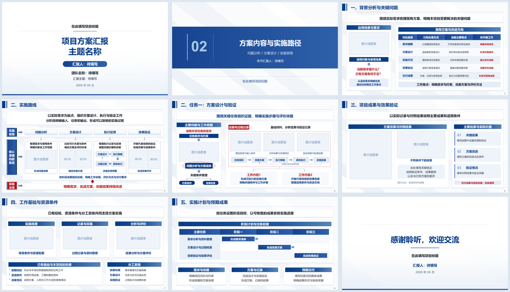
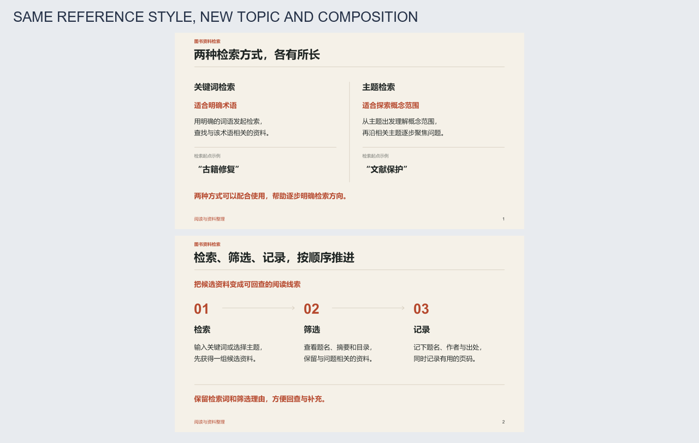

# Reference Slide Workflow

从参考图或 PPT 中提取视觉规则，根据新内容重新组织页面，制作风格一致、可以继续编辑的演示文稿。

An agent skill for reference-based presentation design: understand the visual language, adapt the composition, preview in HTML, export editable PPTX and verify the actual result.


## 它解决什么问题

参考很精致，生成的页面却只剩相似配色；同一个布局反复套用；标题和正文各有一条边；HTML 正常，PPT 导出后跑位。这套工作流把这些问题分成可处理的步骤：

1. 读参考的画布、字体层级、图文比例、信息密度、渐变和对齐关系。
2. 区分需要保持的视觉锚点、可以变化的构图、需要单独授权的身份素材。
3. 根据需求的完整程度写逐页 MD 大纲，明确内容、图表、依据、布局和讲述时间，再做代表页验证。
4. 按用户指示确定素材范围：仅用提供的素材、允许外部补充或允许生成概念图，也支持逐页区别处理。
5. HTML 和 PPT 使用同一份页面源，检查文字容量、关系对齐和实际导出效果。
6. 后续修改只调整必要页面，保留原稿，复用验证过的未变化页面。

它适用于不同主题和风格，不限定科研答辩，也不把字体、蓝色或 16:9 当作全局规则。PNG/JPG、PDF 和 PPTX 都可以作为参考。复杂动画、视频和已有原生对象的保留应进入相应的原生编辑流程，不用静态页面替代它们。

## 安装

在 Codex 中可以让技能安装器安装此仓库的 `skills/reference-slide-workflow` 目录：

```text
请使用 skill-installer，从 https://github.com/forguse/reference-slide-workflow 安装 skills/reference-slide-workflow。
```

也可以下载仓库，在本地运行：

```sh
python install.py
```

脚本安装到个人 Codex skills 目录，保留整个技能和资源。遇到同名已安装目录会停止，不覆盖旧版本。安装后下一轮即可使用 `$reference-slide-workflow`。

## 怎么用

给一张参考图或一份参考 PPT，再给真实内容：

```text
请使用 $reference-slide-workflow，参考附件的视觉风格，按我的材料制作 8 页 PPT。
保留它的字体层级、图文比例和信息密度，根据内容安排布局。
先做 HTML，再导出可编辑 PPT；请自行检查对齐、间距和实际导出效果。
```

没有参考时，可以明确选择内置样式：

```text
请使用 $reference-slide-workflow 的 editorial-light 样式，制作 6 页教学介绍。
```

后续修改时保留完整项目目录：

```text
继续修改这个项目，第 3 页换成这张图并精简说明。
保留其他页面，更新预览，复核变化页和全稿总览后重新导出。
```

如果在 PowerPoint/WPS 中手动改过文件，请提供最新 PPT 并说明“以这份为准”。流程会保留这些修改，不从旧源覆盖。

## 先写清楚每页，再制作

用户只给一个笼统主题时，先阅读材料，由代理补全叙事和页序；要求很明确时，逐项落实到页面；已有大纲时，沿用其结构并补足图文和表达细节。明确要求严格遵循的大纲不会被擅自改写。

每页大纲包括标题、核心信息、拟用文字、来源定位、每张图的内容与作用、图文位置、布局关系和讲述时间。默认保存为 `outline.md`，素材来源、权限、假设和待确认事项另存 `materials-and-decisions.md`。这些制作记录不会变成 PPT 上的免责声明。未要求先审批时，完成大纲后继续制作。

大纲也是逐页设计方案：在这里决定视觉重心、阅读顺序、字体层级与位置、图片裁切和处理、关键留白、风格延续，以及采用这种构图的理由。布局根据该页内容形成，不从固定菜单轮换。新参考项目在排版前检查这些设计项是否齐备；代表页验证后只修订需要改变的方案。

新建自定义项目会检查是否有大纲、要求是否落实到页、页序和时长是否一致，以及实际图片是否在素材记录内。内容准确性与叙事质量仍由代理阅读原材料后判断；几何检查不能代替这一步。局部内容修改只同步相关页，改对齐或间距无需重写大纲。

素材边界按用户指示决定，不按学科猜测。“只用我的材料”不会因为缺图而变成联网找图；“可以找图”也不自动等于允许生成图片。关键事实有疑问时先问清楚，非关键配图候选放在独立文档中集中处理。

图片处理另设边界：证据图保留原始内容；授权的概念或宣传素材可按用途进行AI处理，保留原图与修改记录。允许找图不等于允许改绘用户的实验结果。

## 保留核心风格，拓展页面构图

好的参考可能看着简洁，却依赖精细的裁切、字距、留白、主体层次和图文位置。工作流先提取这些具体关系，再做代表页对照；不能只匹配配色与字体就视为成功。字体数量随参考及页面任务决定，小字也作为完整构图的一部分。

一张参考是视觉语言的样本，不是全稿唯一版式。新内容分别采用主体说明、等权比较、全景与细节、连续过程等合适的构图，保留共同的字体关系、图像处理和视觉节奏。内容关系相同可重复布局，关系改变时调整；不追求无意义的逐页换样式。

新参考项目声明具体`style_targets`，在实际HTML截图上记录保留或适配情况。缺少、未通过或已经过期的风格复核会阻止导出；目标页修改后需重新检查。脚本验证记录是否完整、是否对应当前画面，视觉判断仍由代理负责。普通任务默认形成一个统一风格的页面体系，多风格展示仅在用户要求时采用。

## 三套可选样式


| 样式 | 视觉特征 | 示例 |
|---|---|---|
| `academic-blue` | 蓝色层级、克制渐变、浅色底、紧凑证据页 | [可编辑示例](docs/examples/academic-blue.pptx) |
| `editorial-light` | 暖白纸感、深色文字、陶红强调、开放构图 | [可编辑示例](docs/examples/editorial-light.pptx) |
| `structured-blue` | 浅色斜切底纹、蓝色渐变、四层路线、多图图组和计划矩阵 | [九页可编辑模板](docs/examples/structured-blue.pptx) |

前两套各含六页示例。`structured-blue` 从经用户授权的原参考模板中保留九种版式：封面、章节过渡、问题与比较、四层实施路线、任务与图组、成果与验证、基础与资源、计划与交付、结束页。它保留原有视觉结构，去除所有身份素材与具体研究内容，图片位置改为可编辑占位区。



所有模板均无真实人物、机构标志或私有研究图片。前两套的内容与评分为演示数据，第三套采用通用替换文本。模板是可选起点，用户提供的参考始终优先；示例页数不会限定新任务的页数。

示例图表和表格由可编辑的形状与文字组成。需要 Excel 数据驱动的原生图表时，使用转换器对应的图表能力。

还做了一个换主题测试：只给一张参考图，制作“图书资料检索”的比较页与流程页。新内容采用了新的构图，保留参考的字重、颜色和留白关系。[下载风格迁移示例](docs/examples/reference-transfer.pptx)。



## 修改为什么更快

默认流程是“修改当前页面源 → 刷新 HTML → 检查变化 → 重新导出”。不会为了改一句话重新设计整套页面。自动检查每次覆盖全稿，视觉检查聚焦变化页并查看总览。未变页面只有在源文件、字体环境、渲染器和截图证据都匹配时才复用。

PPT 文件仍由正式转换器完整封装，保证对象关系完整。已有 PPT 被手动修改时，进入原生编辑路线。排版检查由代理完成，不让用户反复逐页找错。

## 写作偏好

优先具体标题和自然短句。默认不反复使用前置中点、连续标签或空泛口号；确实需要列举时才用列表。重要限定保留在相关结论处，其余支撑信息进入备注。

## 运行依赖

技能说明可由代理直接使用。附带的检查与导出脚本需要 Python 3.12+、Node 20+、Playwright/Chromium 和目标字体。图片/PDF 检查用 Pillow/PyMuPDF。PPTX 转换使用单独获取的 [PPT Master](https://github.com/hugohe3/ppt-master)，保留其许可证、署名和完整性检查。实际 PPT 渲染可用宿主提供的 Artifact Tool，或 PowerPoint 等工具导出的逐页 PNG。

不打包字体、第三方转换器或私有运行时。脚本不依赖作者电脑的固定路径。详细命令见 [运行说明](skills/reference-slide-workflow/references/runtime.md)。

## 文档

- [参考风格如何提取](skills/reference-slide-workflow/references/reference-analysis.md)
- [不同详细程度的需求与逐页大纲](skills/reference-slide-workflow/references/brief-and-outline.md)
- [素材边界与待确认事项](skills/reference-slide-workflow/references/material-boundaries.md)
- [样式与页面关系规范](skills/reference-slide-workflow/references/style-schema.md)
- [构图、排版与文案](skills/reference-slide-workflow/references/composition-and-writing.md)
- [局部修改与检查机制](skills/reference-slide-workflow/references/revision-and-review.md)
- [公开发布与素材归属](skills/reference-slide-workflow/references/privacy-and-attribution.md)
- [验证范围](docs/validation.md)

本仓库不上传用户参考材料。生成工作区和发布文件应分开存放；公开分享前检查文字、备注、元数据、媒体和图片像素。原始参考与第三方素材不因套用样式而获得本仓库许可证。

## License

Original code, documentation and neutral presets: [MIT](LICENSE). Third-party dependencies and user-provided assets retain their own terms; see [notices](THIRD_PARTY_NOTICES.md).
