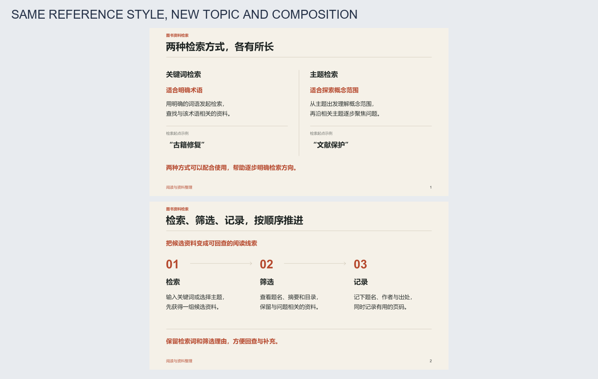

# Validation record

Validated on 2026-11-17. The release uses the pinned PPT Master revision recorded in the dependency lock.

| Check | Result |
|---|---|
| Two optional presets | Six pages each, HTML checked and editable PPTX exported |
| Actual PPTX rendering | All 12 preset pages inspected after export |
| Reference-only transfer | Two new pages on library research, authored from one reference image without being told a preset name |
| Custom canvas | Two 4:3 pages exported, with the requested aspect ratio preserved |
| Layout fault injection | 10 cases passed, including nested transforms, container overflow, text collisions, lines crossing text and unequal gaps |
| Revision behavior | Seven cases passed, including a one-page patch, unchanged-page preservation, stale patch rejection and active SVG rejection |
| Export guards | Three cases passed: valid native PPTX, tiny text-frame rejection and protection of externally edited PPTX |
| Skill packaging | Skill metadata validated and a separate installation test verified copied files |

The reference-only test changed both the topic and composition: an evidence page became a two-column comparison and a three-stage process. It preserved the warm background, type hierarchy, accent color and alignment language. The agent did not simply replace the labels in the reference.

The actual PPTX previews were rendered with the host-provided Artifact Tool. This record does not claim testing in the PowerPoint or WPS user interface. The four test projects completed both HTML and PPTX visual review. Upstream advisory recommendations about SVG grouping and compact style declarations remain advisory; the geometry, package integrity and delivery gates passed.

The 4:3 fixture is a small behavior test, not a designed presentation sample. Editable charts in the supplied samples use native shapes and text, with synthetic data. Photographs, complex animation and native spreadsheet-linked charts are not covered by these samples.

For a new reference, the agent still needs to inspect the visual result. Automated checks catch explicit layout violations; they do not establish whether the style interpretation is attractive or faithful. First delivery requires every page to be reviewed. Revision reviews are tied to source, font environment, renderer and screenshot fingerprints, so an old approval cannot silently certify changed content.

The public tree is separately scanned for personal paths, credentials, private terms, institution markers and text inside Office packages. Raster previews and embedded thumbnails are also inspected. User references, raw conversations and local test logs are outside the public tree.

## Additional reference-derived preset

The `structured-blue` preset adds nine layouts adapted from an authorized reference. All nine passed HTML geometry and font checks, editable PPTX export, package readback and actual PPTX visual review. The original raster assets were not copied: image regions use editable neutral placeholders, and the cover/end background uses anonymous native geometry. All reference text was replaced with generic project text. The raw reference and the private adaptation script are not distributed.

The follow-up also exercised incremental checking: after changing two pages, seven unchanged screenshots were reused. A metadata-only group-bounds fix produced nine screenshots with hashes identical to the reviewed version. The retained-temporary-directory runner was corrected to expose the invoked script's own directory, so its sibling imports behave like a normal direct invocation.
